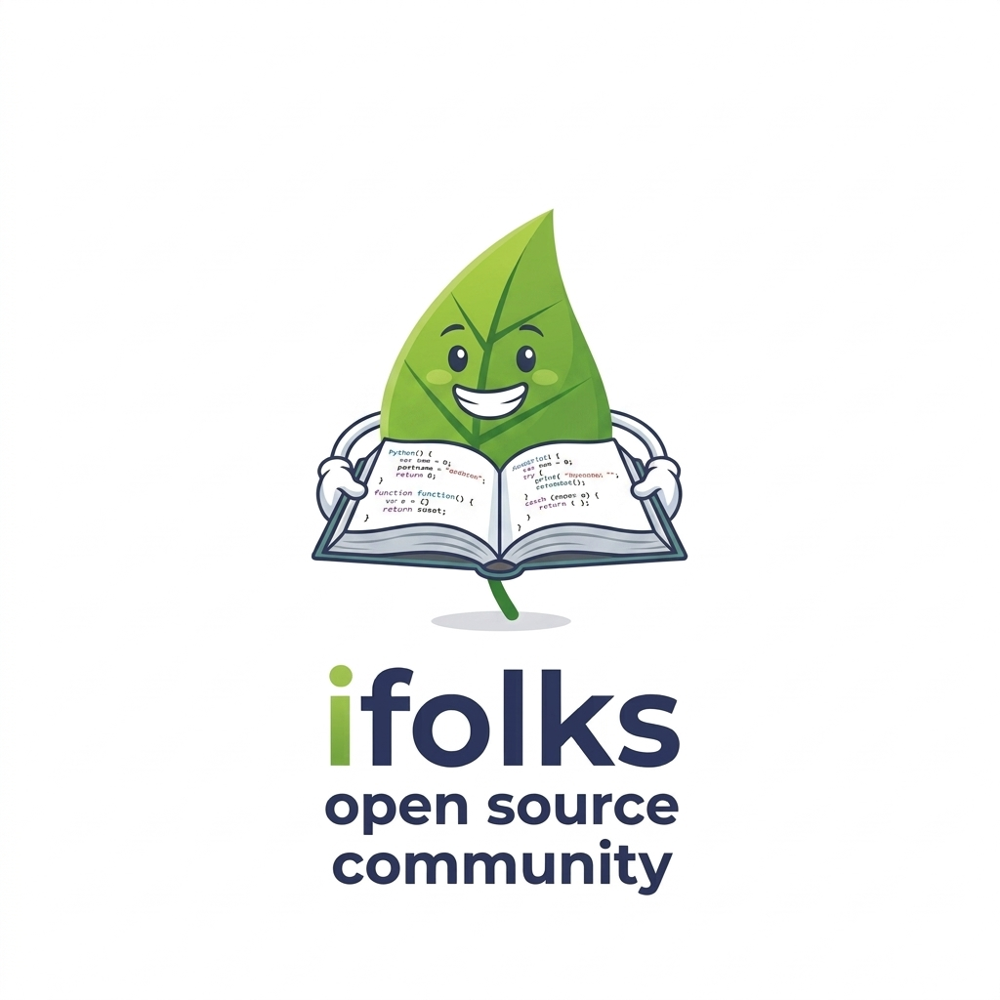

<p align="center">
  
</p>

<h1 align="center">iFolks Demo</h1>

<p align="center">
  <a href="https://ifolks.org"></a>
  
  
  
  
</p>

<p align="center">
  <strong>The Reference Implementation &amp; Showcase Application for the iFolks Open Source Ecosystem</strong>
</p>

---

## 🌟 Overview

**iFolks Demo** is a complete, decoupled enterprise application demonstrating the end-to-end capabilities of the iFolks platform:
* 🛠 **[iFolks Generator](https://generator.ifolks.org)**: Generated directly from metadata declarations (`data-model/skeleton.xml`) with zero boilerplate.
* 🧰 **[iFolks Commons](https://commons.ifolks.org)**: Integrated with structured JSON observability (`ACCESS_LOG`, `ERROR_LOG`), distributed tracing (MDC), context-aware data privacy (`@SensitiveData`), and AspectJ interception.

---

## 🏗 Modular Architecture

The project is organized into clean, decoupled layers:

| Module | Purpose |
| :--- | :--- |
| **`demo-api`** | Public DTOs, interfaces, and service contracts |
| **`demo-model`** | JPA domain entities |
| **`demo-persistence`** | Repositories and database access layer |
| **`demo-services`** | Business service implementations |
| **`demo-rest`** | Spring Boot REST controllers |
| **`demo-populator`** | Automated multi-step database provisioning and seed data |
| **`demo-tests`** | Comprehensive integration and regression test suites |
| **`demo-ui`** | Angular frontend application |

---

## ⚡ Quickstart

### Prerequisites
* **Java 21** or later
* **Maven 3.9+**

### 1. Build and Run Tests
```bash
mvn clean install
```

### 2. Launch the Spring Boot Backend
```bash
cd demo-rest
mvn spring-boot:run
```

---

## 📖 Official Documentation

For architectural guides, model specifications, and community resources:
* 🌐 **Community Portal**: [ifolks.org](https://ifolks.org)
* 🛠 **Generator Documentation**: [generator.ifolks.org](https://generator.ifolks.org)
* 🧰 **Commons Documentation**: [commons.ifolks.org](https://commons.ifolks.org)

---

## 📝 License

Distributed under the **Apache Software License, Version 2.0**.
